<div align="center">

# 🍲 LocalChefBazaar

### A marketplace that connects home chefs with people who crave real, home-cooked food

<br />

[](https://localchefbazaarbd.vercel.app)

<br />


**[Live Site](https://localchefbazaarbd.vercel.app)** · **[Server Repository](<https://github.com/minhazahmmed/Local-Chef-Bazar-Server>)**

</div>

---

## Table of Contents

- [About the Project](#about-the-project)
- [Screenshots](#screenshots)
- [Key Features](#key-features)
- [Tech Stack](#tech-stack)
- [Project Structure](#project-structure)
- [Getting Started](#getting-started)
- [Environment Variables](#environment-variables)
- [Deployment](#deployment)
- [Related Repository](#related-repository)
- [Developed By](#developed-by)

---

## About the Project

**LocalChefBazaar** is a full-stack MERN marketplace where home chefs can list the meals they cook, and customers can browse, order, pay online and review them. The platform has three roles, each with its own dashboard: **User**, **Chef** and **Admin**.

This repository contains the **client (front end)**. The REST API lives in a separate repository, linked [below](#related-repository).

---

## Screenshots

<div align="center">

### Home Page

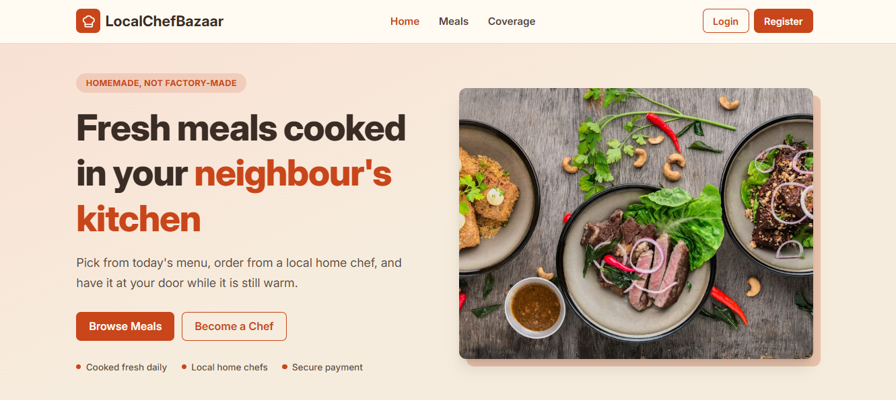

<details>
  <summary><b>View full home page</b></summary>
  <br />
  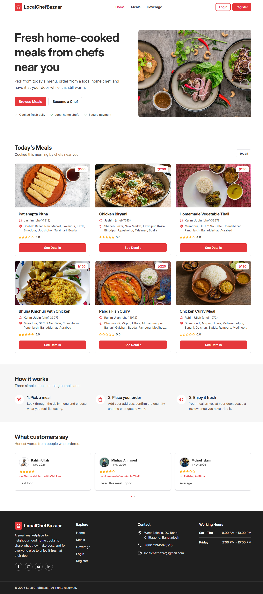
</details>

<br />

### Meals and Meal Details

<table>
  <tr>
    <td width="50%">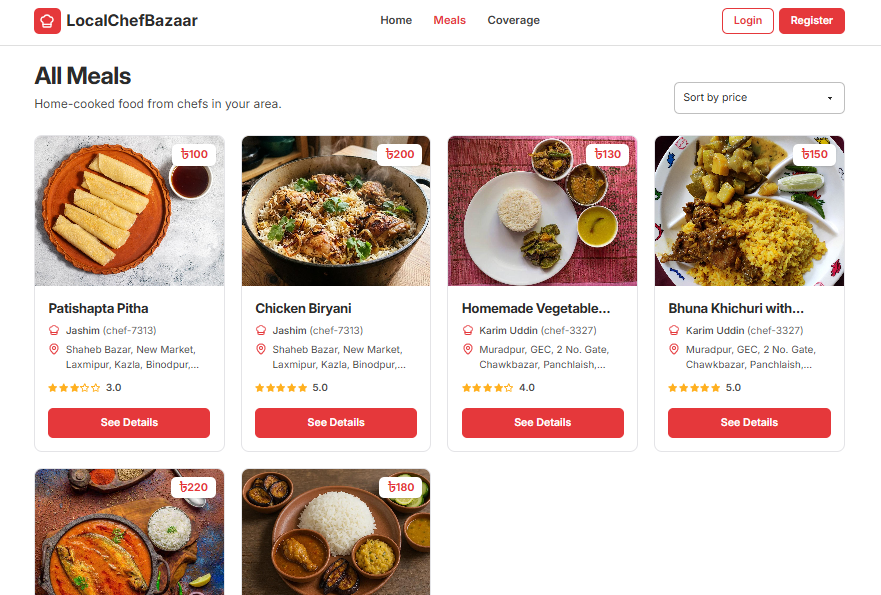</td>
    <td width="50%">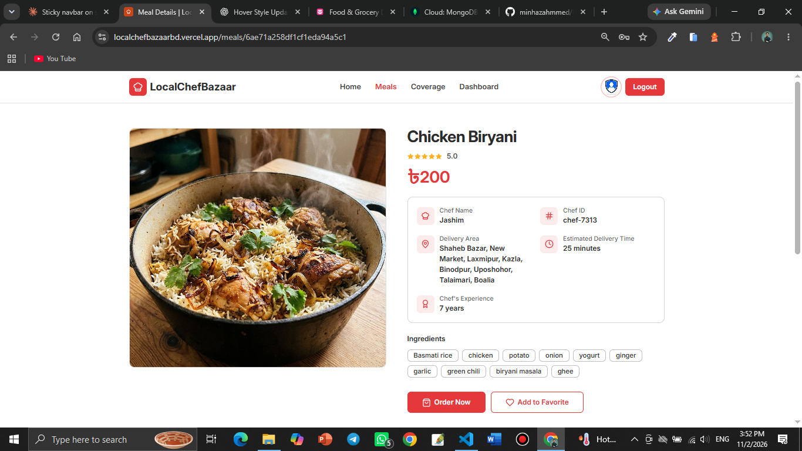</td>
  </tr>
</table>

### Coverage Map

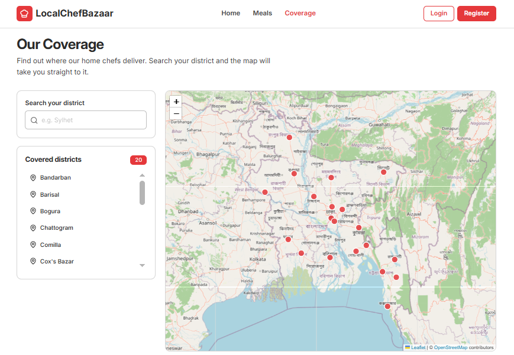

<br />
<br />

### Role Based Dashboards

<table>
  <tr>
    <th width="33%">User</th>
    <th width="33%">Chef</th>
    <th width="33%">Admin</th>
  </tr>
  <tr>
    <td>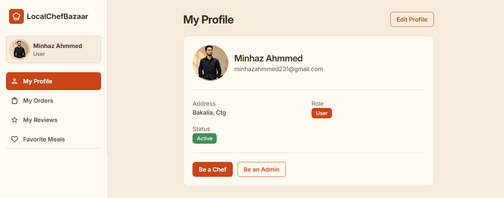</td>
    <td>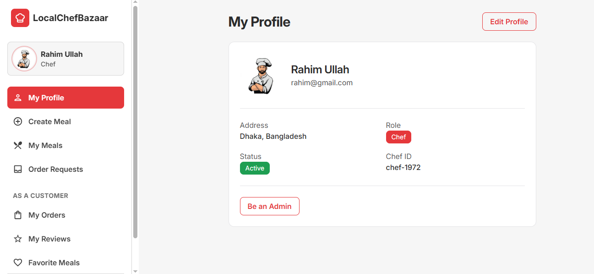</td>
    <td>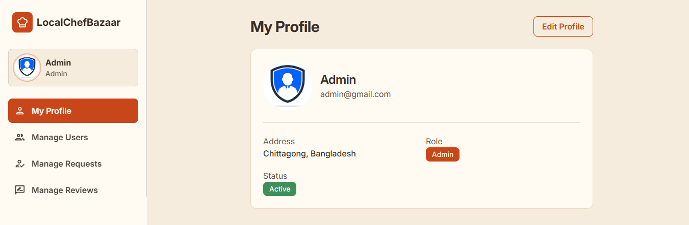</td>
  </tr>
</table>

### Mobile View

<table>
  <tr>
    <td width="33%" valign="top">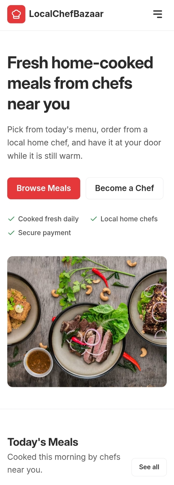</td>
    <td width="33%" valign="top">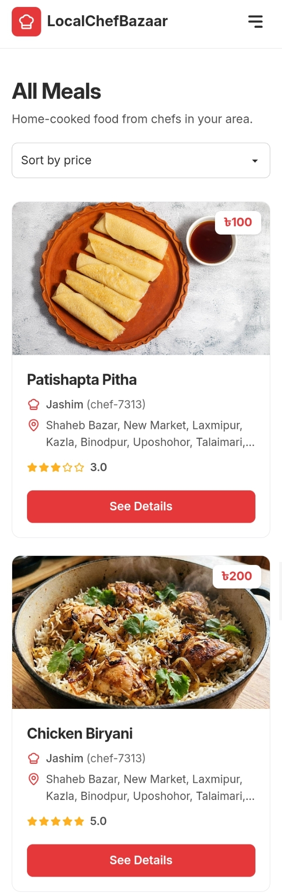</td>
    <td width="33%" valign="top">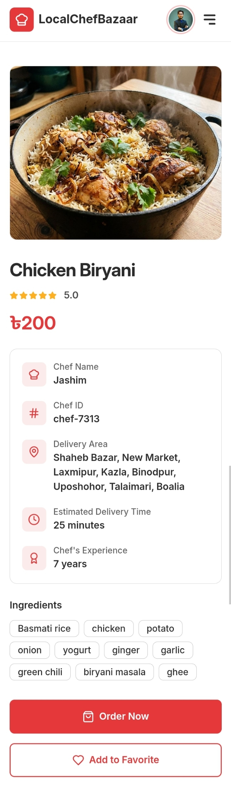</td>
  </tr>
  <tr>
    <td width="33%" valign="top">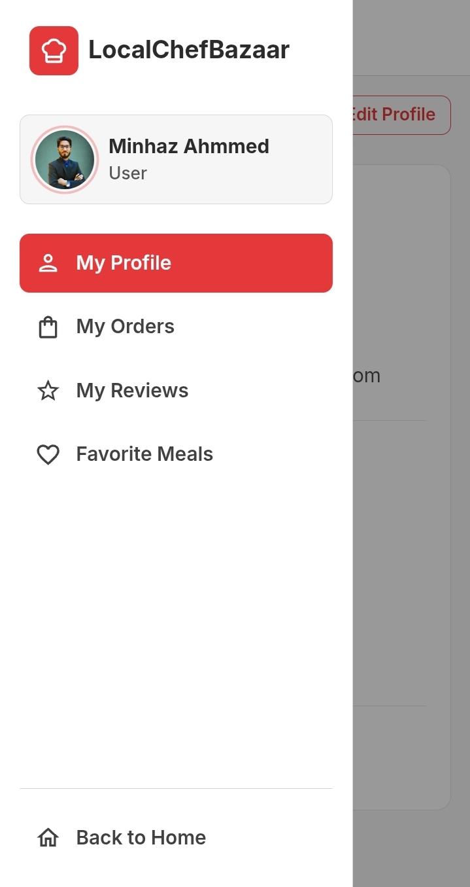</td>
    <td width="33%" valign="top">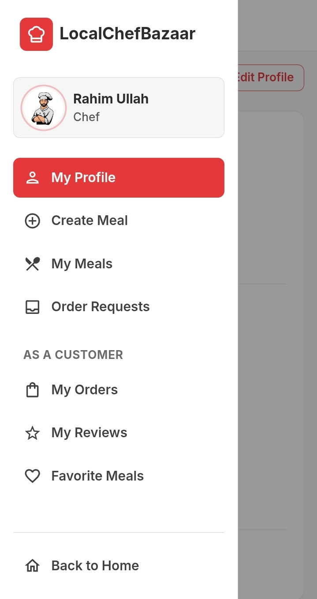</td>
    <td width="33%" valign="top">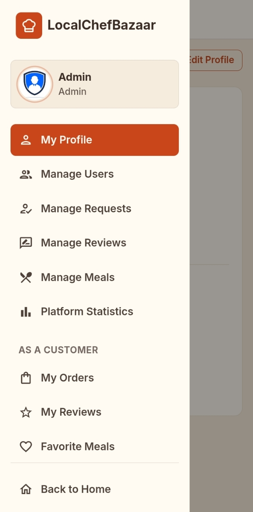</td>
  </tr>
</table>

</div>

---

## Key Features

### Public
- Clean, fully responsive home page with a hero banner, featured meals and customer reviews
- **Meals page** with sorting by price
- **Meal details** page with chef information, ingredients, ratings and reviews
- **Coverage page** with an interactive map of Bangladesh, a district search that zooms in and highlights the district, and tooltips showing where home chefs deliver

### Authentication
- Email and password registration and login
- Google sign in
- Forgot password email flow
- Protected routes for logged in users and role based dashboards
- Login and register pages are hidden from users who are already signed in
- Firebase ID token sent as a Bearer token with every secured request

### User Dashboard
- My Profile, with the option to request a Chef or Admin role
- Place orders and track their status in real time
- Pay online with Stripe Checkout once the chef accepts an order
- Write, edit and delete reviews
- Save and remove favorite meals

### Chef Dashboard
- Create, update and delete meals, with image upload to Cloudinary
- Order Requests with filter tabs, search, and Accept, Cancel and Deliver actions
- Delivery is allowed only after the customer has paid
- Clear delivered and cancelled orders from the list

### Admin Dashboard
- **Manage Users**: change roles, mark users as fraud or restore them, with search, role filter and pagination
- **Manage Requests**: approve, reject or reopen chef and admin role requests, with search, status filter and pagination
- Platform statistics with charts

### UI and Experience
- Light theme, Inter font, and a consistent warm color palette
- Mobile first layouts, with cards on small screens and tables on large screens in the dashboard
- Toast notifications, confirmation dialogs and loading states for every action
- Route level code splitting to keep the first load fast

---

## Tech Stack

| Category | Technologies |
| --- | --- |
| Framework | React 19, Vite |
| Routing | React Router v7 |
| Styling | Tailwind CSS v4, DaisyUI v5 |
| Data Fetching | TanStack Query v5, Axios |
| Forms | React Hook Form |
| Authentication | Firebase Authentication |
| Payments | Stripe Checkout |
| Image Upload | Cloudinary |
| Maps | Leaflet, React Leaflet, OpenStreetMap |
| UI Libraries | Swiper, Framer Motion, Recharts, React Icons |
| Feedback | React Hot Toast, SweetAlert2 |
| Hosting | Vercel |

---

## Project Structure

```text
src/
├── api/            Axios instances
├── assets/         Images
├── components/     Reusable and shared UI components
├── contexts/       Auth context and provider
├── data/           Static data, such as district list
├── hooks/          Custom hooks (useAuth, useAxiosSecure, useTitle)
├── layouts/        Main and dashboard layouts
├── pages/          Public pages and dashboard pages
├── routes/         Router, private, public and role based routes
└── utils/          Helpers (formatters, image upload)
```

---

## Getting Started

### Prerequisites
- Node.js 20 or newer
- A Firebase project, a Cloudinary account, and the running [server](<https://github.com/minhazahmmed/Local-Chef-Bazar-Server>)

### Installation

```bash
git clone https://github.com/minhazahmmed/Local-Chef-Bazar-Client.git
cd Local-Chef-Bazar-Client
npm install
npm run dev
```

The app runs at `http://localhost:5173`.

### Available Scripts

| Command | Description |
| --- | --- |
| `npm run dev` | Start the development server |
| `npm run build` | Create a production build |
| `npm run preview` | Preview the production build |
| `npm run lint` | Run ESLint |

---

## Environment Variables

Create a `.env.local` file in the project root:

```env
VITE_API_URL=http://localhost:5000

VITE_FIREBASE_API_KEY=
VITE_FIREBASE_AUTH_DOMAIN=
VITE_FIREBASE_PROJECT_ID=
VITE_FIREBASE_STORAGE_BUCKET=
VITE_FIREBASE_MESSAGING_SENDER_ID=
VITE_FIREBASE_APP_ID=

VITE_CLOUDINARY_CLOUD_NAME=
VITE_CLOUDINARY_UPLOAD_PRESET=
```

> Vite bakes `VITE_` variables in at build time, so redeploy after changing them.

---

## Deployment

The client is deployed on **Vercel**. Every push to the `main` branch triggers an automatic deployment. Add the same environment variables in the Vercel project settings, and add the live domain to Firebase **Authorized domains** so Google sign in works.

---

## Related Repository

| Repository | Description |
| --- | --- |
| [LocalChefBazaar Server](<https://github.com/minhazahmmed/Local-Chef-Bazar-Server>) | Express and MongoDB REST API, Stripe payments and Firebase token verification |

---

## Developed By

<div align="center">

## Minhaz Ahmmed

MERN Stack Developer


CSE Student, International Islamic University Chittagong

<br />

[](https://linkedin.com/in/minhaz-ahmmed)
[](https://github.com/minhazahmmed)
[](<https://facebook.com/minhaz.ahmmed.98>)
[](https://minhazahmmed.vercel.app)

<br />

⭐ If you like this project, please consider giving it a star.

</div>